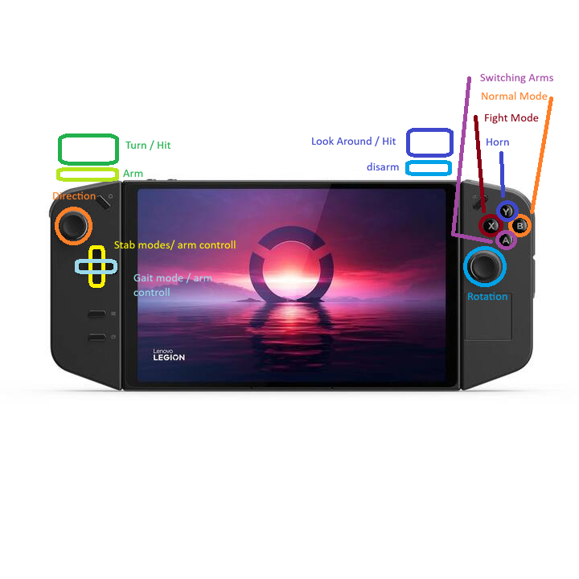

# Hexapod-Controller

Remote control client for a six-legged walking robot. It runs on a Linux PC or
handheld (developed on a Lenovo Legion Go), reads a gamepad, sends the input to
the robot over the network, and shows the robot's camera stream and telemetry
in a fullscreen window.



## Where it fits

```
Controller PC  --TCP/UDP-->  Raspberry Pi 5  --UART-->  STM32 mainboard
(this repo)                  (Hexapod-Pi5)              (Hexapod-STM32)
```

| Repository | Content |
|---|---|
| [Hexapod](https://github.com/Jiggolino/Hexapod) | Main repository: CAD, PCB, documentation |
| [Hexapod-STM32](https://github.com/Jiggolino/Hexapod-STM32) | Mainboard firmware: gait, kinematics, sensors |
| [Hexapod-Pi5](https://github.com/Jiggolino/Hexapod-Pi5) | Relay on the Raspberry Pi 5: network to UART, camera, sound |
| Hexapod-Controller | This repository |

The controller does not interpret the gamepad itself. It sends the raw stick
and button state 50 times per second; the STM32 firmware decides what the robot
does with it.

## Requirements

- Linux with an X11 session (the video is embedded with `xvimagesink`, and the
  app uses `ping -c` and `/dev/input`). On Wayland it needs XWayland.
- Python 3 with tkinter
- GStreamer 1.0 with the plugins that provide `udpsrc`, `rtph264depay`,
  `h264parse`, `avdec_h264` (gst-libav), `videoconvert` and `xvimagesink`
- Python packages: `pygame`, `PyGObject` (see `requirements.txt`)
- A gamepad. Any gamepad known to SDL works for sticks and buttons; the button
  numbers are set up for the Legion Go (Xbox-style layout).
- Network access to the Pi 5 running
  [Hexapod-Pi5](https://github.com/Jiggolino/Hexapod-Pi5). The defaults are
  Tailscale addresses.

## Install

PyGObject and GStreamer are easiest to install from the distribution packages.
Package names differ between distributions, for example:

```sh
# Debian / Ubuntu
sudo apt install python3-tk python3-gi gir1.2-gstreamer-1.0 gir1.2-gst-plugins-base-1.0 \
    gstreamer1.0-plugins-base gstreamer1.0-plugins-good gstreamer1.0-libav

# Arch / Manjaro
sudo pacman -S tk python-gobject gstreamer gst-plugins-base gst-plugins-good gst-libav
```

Then create a virtual environment that can see the system packages and install
the rest:

```sh
git clone https://github.com/Jiggolino/Hexapod-Controller.git
cd Hexapod-Controller
python3 -m venv --system-site-packages .venv
.venv/bin/pip install -r requirements.txt
```

## Run

```sh
./Hexapod_Controller                 # uses .venv if present, else system python3
./Hexapod_Controller --host 192.168.1.50
```

or directly: `python3 hexapod_control.py [options]`.

Start the relay on the Pi 5 first. The window opens fullscreen; leave with the
red LEAVE button.

## Configuration

| Option | Default | Meaning |
|---|---|---|
| `--host` | `100.122.9.49` | Address of the Pi 5 relay |
| `--port` | `5000` | TCP port of the command and telemetry link |
| `--speaker-port` | `5001` | TCP port of the relay's text-to-speech server |
| `--camera-port` | `5005` | Local UDP port on which the camera stream arrives |

The defaults are constants at the top of `hexapod_control.py`, next to the
gamepad axis and button numbers, the stick dead zone (`0.12`) and the trigger
threshold.

The relay sends the camera stream to a fixed address (its `--video-host`
option). That address has to be the machine this controller runs on.

## User interface

- Camera stream on the left, with a stream status line.
- CMD bar below the video: text typed here is sent to the relay's speaker port
  and spoken by the robot. Tapping the field opens an on-screen keyboard.
- Panels on the right: connection state, gait mode, stabiliser mode, roll and
  pitch, distance sensor, ping, battery voltage and charge, live gamepad state,
  packet statistics, log.
- The app pings the relay every 2 seconds and reconnects automatically when the
  TCP link was lost and the relay is reachable again.

## Controls

What the controller sends:

| Input | pygame index | Packet field |
|---|---|---|
| Left stick X / Y | axis 0 / 1 | `lsx`, `lsy` |
| Right stick X / Y | axis 3 / 4 | `rsx`, `rsy` |
| LT / RT | axis 2 / 5 (pressed above -0.9) | `trig` bit 0 / bit 3 |
| D-pad | hat 0 | `hat_x`, `hat_y` |
| A, B, X, Y | button 0, 1, 2, 3 | `face` bit 1, 2, 0, 3 |
| LB / RB | button 4 / 5 | `trig` bit 2 / bit 4 |
| Back / Start | button 6 / 7 | `trig` bit 1 / bit 5 |
| R3 / L3 | button 8 / 9 | `sticks` bit 1 / bit 0 |
| Back paddles M1-M3, Y1-Y3 | Legion keyboard evdev device | `back` bits 0-5 |

What the robot does with it is defined in
[Hexapod-STM32](https://github.com/Jiggolino/Hexapod-STM32) (and, for the horn,
in Hexapod-Pi5). At the time of writing:

| Input | Action |
|---|---|
| LB | Arm: centre the servos, enable them, stand up |
| RB | Disarm: servo outputs off (works in every state) |
| Left stick | Walk in that direction |
| Right stick X | Rotate while walking |
| LT (hold) | Turn on the spot; in fight mode: hit |
| RT (hold) | Look around: the right stick tilts and turns the body; in fight mode: hit |
| D-pad left / right | Cycle the gait (Tripod, Wave, Ripple, Obstacle); in fight mode: move the raised leg |
| D-pad up / down | Cycle the stabiliser mode (Off, Stable, Level); in fight mode: move the raised leg |
| X | Fight mode: stand and walk on four legs with the front legs raised |
| A | In fight mode: switch which front leg is controlled (right, left, both) |
| B | Back to normal mode |
| Y | Dance, and the horn sounds |

The back paddles are transmitted but the firmware does not use them. Their key
codes (`BACK_KEY_*` in `hexapod_control.py`) are device specific; check them
with `sudo evtest` if you want to use them.

## Protocol

All messages on the command link (TCP 5000) are ASCII lines ending in `\n`.
The relay forwards them unchanged to the STM32 and sends the answers back.

Controller to robot:

| Line | Rate | Meaning |
|---|---|---|
| `/CONTROLL/{rsx},{rsy},{lsx},{lsy},{hat_x},{hat_y},{face},{sticks},{trig},{back}` | 50 Hz | Gamepad state. Sticks are integers from -100 to 100, hat values are -1, 0 or 1, the rest are bit masks. |
| `/BATTERY/V` | 1 Hz | Request battery voltage |
| `/BATTERY/P` | 1 Hz | Request battery charge |
| `/MODE` | 1 Hz | Request gait mode |
| `/STAB` | 10 Hz | Request stabiliser mode |
| `/TILT` | 10 Hz | Request roll and pitch |
| `/TOF` | 10 Hz | Request distance sensor reading |

Bit masks:

| Field | Bit 0 | Bit 1 | Bit 2 | Bit 3 | Bit 4 | Bit 5 |
|---|---|---|---|---|---|---|
| `face` | X | A | B | Y | | |
| `sticks` | L3 | R3 | | | | |
| `trig` | LT | Back | LB | RT | RB | Start |
| `back` | M1 | M2 | M3 | Y1 | Y2 | Y3 |

Robot to controller:

| Line | Meaning |
|---|---|
| `/BATTERY/V/<volts>` | Battery voltage |
| `/BATTERY/P/<percent>` | Battery charge; smoothed in the UI with an exponential filter (alpha 0.1) |
| `/MODE/<name>` | Gait mode |
| `/STAB/<name>` | Stabiliser mode |
| `/TILT/<roll>,<pitch>` | Body angles in degrees |
| `/TOF/<mm>` | Distance in millimetres |

Any other line is shown in the log panel.

Other connections:

- TCP 5001: one connection per message; the UTF-8 text is spoken by the robot.
- UDP 5005: incoming camera stream, H.264 in RTP (payload type 96).

## Building a standalone binary

Binaries are not kept in the repository. Publish them as assets of a
[GitHub Release](https://github.com/Jiggolino/Hexapod-Controller/releases).
To build one for the machine you are on:

```sh
.venv/bin/pip install pyinstaller
.venv/bin/pyinstaller hexapod_control.spec
```

The result is the single file `dist/hexapod_control`. GStreamer still has to be
installed on the machine that runs it.

## Troubleshooting

- **DISCONNECTED / "Relay error"**: the relay is not running or `--host` is
  wrong. Check `ping <host>` and that port 5000 is reachable.
- **"Waiting for stream..." never changes**: the relay sends the video to its
  `--video-host`, which must be this machine's address, and UDP port 5005 must
  not be blocked by a firewall. The stream only runs while the controller is
  connected.
- **"Pipeline error"**: a GStreamer plugin is missing (usually gst-libav for
  `avdec_h264`).
- **"No controller found"**: the gamepad must be connected before the app
  starts.
- **"Back paddles: device not found" / "No access to /dev/input/..."**: add
  your user to the `input` group (`sudo usermod -aG input $USER`) and log in
  again. Without it everything except the back paddles still works.

## License

MIT, see [LICENSE](LICENSE).
